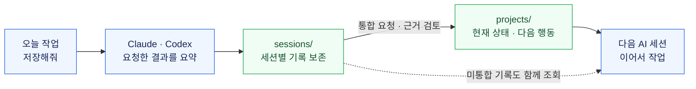
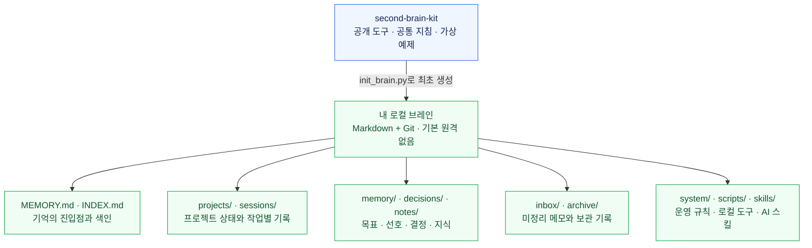

# Second Brain Kit

**Markdown + Git으로 기록하고, Claude·Codex에서 이어 쓰는 세컨브레인 스타터.**

A local-first, file-based second brain for AI-assisted work. Plain Markdown, immutable session notes, explicit project ownership, deterministic indexes, and reviewable Git changes. Python standard library only.

이 저장소에는 도구·공통 지침·빈 기록 구조·가상 예제만 있습니다. 실제 개인 기록은 아래 설치 도구로 별도 저장소에 만드세요.

## 한눈에 보는 사용 흐름

**작업 결과를 파일에 남기고, 다음 AI 세션이 그 기록을 읽어 이어서 작업합니다.**
저장과 통합은 사용자가 요청할 때 진행합니다.



예를 들어 오늘 “요구사항 정리 완료, 구현은 아직”을 저장하면, 다음 세션에서 완료한 일과 남은 일을 구분해 복구합니다.
통합할 때 충돌하는 내용은 확정하지 않고 원래 세션 기록과 함께 통합 대기로 남깁니다.

## 어디에 무엇이 저장되나요?

다운로드한 공개 도구로 **나만의 로컬 브레인**을 따로 만듭니다. 실제 기록은 그 로컬 브레인 안에 쌓입니다.



AI는 공통 지침과 색인에서 필요한 기록을 찾고, 로컬 도구는 저장·통합·검사·Git 변경을 처리합니다.
개인 브레인과 업무 브레인은 각각 별도 저장소로 운영합니다.

## 5분 안에 시작하기

필수: **Python 3.10 이상, Git 2.28 이상**. 기본 기능은 macOS·Linux에서 동작하며 파일 잠금에 POSIX fcntl을 사용합니다.
Windows에서는 WSL을 사용하세요. GitHub·AI·데이터베이스 연결 없이 로컬 도구를 쓸 수 있습니다.

```bash
git clone https://github.com/westtrain/second-brain-kit.git
cd second-brain-kit
python3 scripts/init_brain.py --target ~/brains/my-second-brain
cd ~/brains/my-second-brain
python3 scripts/brain.py check
```

생성 도구는 기존 경로를 덮어쓰지 않습니다. 새 Git 저장소·빈 프로젝트 등록부·검사 훅을 만들고 첫 로컬 커밋을 남깁니다.
원격·GitHub 계정·개인 사실·예약 실행을 자동으로 설정하지 않습니다.
GitHub의 **Download ZIP**이나 [릴리스](https://github.com/westtrain/second-brain-kit/releases)로 받은 도구도 같은 명령으로 실행할 수 있습니다.

생성한 브레인을 원하는 AI의 작업 폴더로 열고 이렇게 시작하세요.

> AGENTS.md를 읽고 시작해줘. 독서 앱을 만드는 프로젝트를 새로 등록하고, 오늘은 요구사항을 정리했다는 세션 요약을 저장해줘. 지금은 앱 구현이나 배포를 완료한 상태가 아니야.

다음 세션에서는:

> 이 프로젝트 어디까지 진행됐는지 정본과 미통합 세션을 함께 확인해줘. 이번에는 읽기 전용이야.

세션을 모아 정본에 반영할 때는:

> 쌓인 기록을 이 프로젝트에 통합해줘. 충돌하는 내용은 확정하지 말고 따로 보여줘.

## 제공하는 기능

- 불변 세션 요약과 별도 프로젝트 정본 통합. 중복 저장과 오래된 snapshot 반영을 차단합니다.
- 등록부로 프로젝트 목표·별칭·하위 세션 그룹을 명시합니다.
- `MEMORY.md → INDEX.md → 프로젝트 → 최신 pending` 순서로 기억을 복구합니다.
- 색인을 결정적으로 생성하고 오래된 내용·출처 누락·고아·충돌 키워드를 읽기 전용으로 점검합니다.
- linked worktree·검사·커밋·위험에 따른 병합 흐름을 공통 실행기로 처리합니다.
- 개인/업무 저장소 분리, 특정 검토본의 경험 전달, 기기별 스킬 설치, 로컬 백업 도구를 제공합니다.

기본 도구는 AI를 호출하지 않습니다. 자연어 해석·요약·모순 판단은 사용하는 AI와 사용자가 담당합니다.
패턴 검사 통과가 민감도·사실성 검증이나 공개 승인을 뜻하지는 않습니다.

## 다른 작업 폴더에서 저장하기

**공개 toolkit이 아니라 생성한 브레인 폴더 안에서** 스킬을 설치하세요.

```bash
python3 scripts/install_sync_skill.py
```

기본 위치는 `~/.claude/skills/second-brain-sync`입니다. Codex용 설치 위치를 직접 지정할 수도 있습니다.

```bash
python3 scripts/install_sync_skill.py --target ~/.agents/skills/second-brain-sync
```

처음 설치하면 config.json의 personal이 생성한 브레인을 가리키고 work는 null입니다. 기존 config는 보존합니다.
설치 경로가 symlink이면 기존 설치 위치를 확인하고 실제 디렉터리를 지정하세요.
work·work_source_roots·github_accounts는 필요한 경우에만 기기별로 설정합니다. 설정과 자격증명은 Git에 넣지 않습니다.
스킬을 인식하는 새 AI 세션에서 “오늘 작업 결과를 세컨브레인에 저장해줘”라고 요청할 수 있습니다.
스킬 설치 없이도 AGENTS.md를 읽는 AI 작업 폴더로 사용할 수 있습니다.

## 로컬 명령

```bash
python3 scripts/brain.py search '검색어' --sessions
python3 scripts/session_sync.py catalog
python3 scripts/session_sync.py snapshot --project '<등록한-id>'
python3 scripts/memory_tools.py index --check
python3 scripts/memory_tools.py audit --json
```

쓰기는 정본의 `sync_workflow.py`를 사용합니다. 기록·등록·통합마다 별도 worktree를 만들고 검사합니다.
색인의 수동 재생성은 작업별 linked worktree 안에서 `python3 scripts/memory_tools.py index`로 수행합니다.
[직접 CLI 예제](docs/cli-example.md), [운영 흐름](system/workflows.md), [Git 절차](system/git-workflow.md)를 참고하세요.

## 기록과 공개 저장소를 분리하세요

새 브레인은 원격이 없는 로컬 저장소입니다. 이 공개 toolkit의 origin을 실제 기록 저장소에 복사하지 마세요.
개인 원격이 필요하면 사용자가 소유한 별도 private 저장소를 명시적으로 선택하세요.
업무 기록은 허용된 별도 업무 저장소에 두고, 개인/공개 저장소로 원본·색인·출처를 옮기지 않습니다.
[정보 경계](system/privacy.md)와 [경험 검토 절차](system/experience-export.md)를 따릅니다.

## 검증과 기여

```bash
python3 -m unittest discover -s tests -v
python3 scripts/brain.py check
python3 scripts/memory_tools.py index --check
```

가상 데이터로 저장·통합·계정 분리·설치·백업·색인·경로 보호를 검증합니다.
기여는 [CONTRIBUTING.md](CONTRIBUTING.md)를 참고하세요. 실제 메모·로그·기기 설정을 이슈나 PR에 첨부하지 마세요.

v0.1.0은 로컬 기록·조회·통합 도구를 배포합니다. 모델 기반 예약 통합·블로그 자동 생성은 포함하지 않습니다.
백업 위치·외부 업로드·자동 일정은 사용자가 별도로 선택합니다.

## 라이선스

[MIT](LICENSE). 사용·수정·재배포할 수 있으며 저작권 및 라이선스 고지를 유지해야 합니다.
