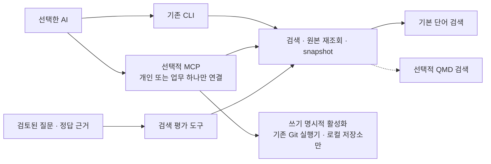
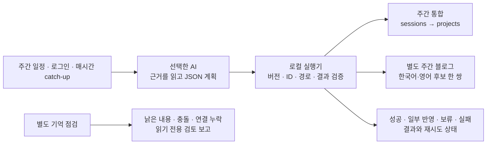

# Second Brain Kit

**Claude · Codex · Gemini · Grok이 같은 Markdown 기억을 읽고 이어서 일하는 세컨브레인.**

개인과 업무를 두 저장소로 나누고, 세션 기록·프로젝트 정본·결정·지식을 Git으로 관리합니다.
실제 운영과 같은 구조·도구·검토 절차를 제공하며, 실제 기록과 기기 설정은 포함하지 않습니다.

**기본은 가벼운 CLI입니다.** 검색 평가 도구를 함께 제공하며, MCP 연결과 QMD 검색은 필요한 경우에만 추가합니다.

## 한눈에 보는 전체 구조

```mermaid
flowchart TB
    ai["Claude · Codex · Gemini · Grok"] --> common["공통 지침 · 스킬 · 로컬 도구<br/>AGENTS → MEMORY → INDEX → 관련 기록"]
    common --> personal
    common --> work
    subgraph personal["개인 브레인 · 독립 Git 저장소"]
        pcore["projects · sessions<br/>memory · notes · decisions · inbox · archive"]
        career["career/companies<br/>회사별 경력과 승인된 경험"]
        learning["learnings · blog<br/>배움과 한국어·영어 글"]
    end
    subgraph work["업무 브레인 · 독립 Git 저장소"]
        wcore["projects · sessions<br/>memory · notes · decisions · inbox · archive"]
        issues["findings · incidents<br/>미해결 문제와 실제 장애"]
        candidates["exports/candidates<br/>일반화한 경험·블로그 후보"]
        reviews["exports/reviews<br/>개인 보관용 본문 검토"]
        candidates --> reviews
    end
    reviews --> approval{"사용자가 특정 본문 승인"}
    approval -->|승인된 경력 본문만| career
    approval -->|승인된 배움·글 본문만| learning
```



업무 원본·프로젝트 색인·출처·검토 메모는 업무 브레인에 유지합니다. 승인된 정확한 본문만 개인으로 전달합니다.
개인 보관과 공개 게시는 각각 별도 승인입니다.

## 어떻게 기억하나요?


예를 들어 “요구사항 정리 완료, 구현은 아직”을 저장하면 다음 AI가 완료·미완을 구분해 복구합니다.
세션 원문은 불변이며 정정은 새 세션으로 남깁니다. 충돌은 날짜만으로 확정하지 않고 pending에 유지합니다.
목표·선호는 memory, 이유 있는 결정은 decisions, 재사용할 지식은 notes에 둡니다.

## 5분 안에 시작하기

Python 3.10+, Git 2.28+가 필요합니다. macOS·Linux에서 동작하며 Windows는 WSL을 사용합니다.
기본 도구는 Python 표준 라이브러리만 사용합니다. 자연어 작업과 예약 계획은 선택한 AI CLI 및 해당 계정이 필요합니다.

```bash
git clone https://github.com/westtrain/second-brain-kit.git
cd second-brain-kit
python3 scripts/init_brain.py --pair --target ~/brains/my-second-brain
```

[릴리스 ZIP](https://github.com/westtrain/second-brain-kit/releases)으로 받아도 같은 생성 명령을 실행할 수 있습니다.
기존 경로를 덮어쓰지 않습니다. 원격·계정·예약을 자동 설정하지 않습니다.

```text
my-second-brain/
├── config.json              # 기기별 경로, 공개하지 않음
├── personal/                # 개인 Git 저장소, 기본 원격 없음
│   ├── MEMORY.md · INDEX.md
│   ├── projects/ · sessions/ · memory/ · notes/ · decisions/
│   ├── career/companies/ · learnings/ · blog/
│   └── inbox/ · archive/
└── work/                    # 업무 Git 저장소, 기본 원격 없음
    ├── MEMORY.md · INDEX.md
    ├── projects/ · sessions/ · memory/ · notes/ · decisions/
    ├── findings/ · incidents/
    ├── exports/candidates/ · exports/reviews/
    ├── inbox/ · archive/
    └── automation/
```

각 저장소에는 AGENTS.md·CLAUDE.md·GEMINI.md, system/·scripts/·skills/·templates/·tests/도 함께 설치됩니다.
처음에는 빈 등록부와 운영 템플릿뿐이며, 회사명·프로젝트·사용자 사실은 추정하지 않습니다.
개인 브레인만 필요하면 `--pair` 없이, 업무 하나만 만들려면 `--scope work`를 사용하세요.

## 네 AI에서 같은 방식으로 쓰기

생성한 브레인 폴더를 선택한 AI의 작업 폴더로 열고 공통 지침을 읽도록 요청하세요.

| AI | 진입점 | 스킬 설치 provider |
|---|---|---|
| Claude Code | CLAUDE.md → AGENTS.md | claude |
| Codex | AGENTS.md | codex |
| Gemini CLI | GEMINI.md → AGENTS.md import | gemini |
| Grok Build | AGENTS.md | grok |

다른 작업 폴더에서도 저장하려면 생성한 개인 브레인 안에서 원하는 provider로 설치합니다.

```bash
cd ~/brains/my-second-brain/personal
python3 scripts/install_sync_skill.py --provider gemini --config ../config.json
# 다른 선택: --provider claude / codex / grok
```

기존 설치 설정은 보존합니다. 새 설치에는 부모 config.json의 개인/업무 경로가 함께 들어갑니다.
실제 계정 로그인은 각 CLI에서 수행하세요. [AI별 공식 근거·설정·제약](system/ai-providers.md)을 확인할 수 있습니다.
웹/앱처럼 로컬 파일 도구가 없는 환경은 필요한 문서를 수동 전달하며 자동 파일 동기화를 가정하지 않습니다.

> AGENTS.md를 읽고 독서 앱 프로젝트를 등록해줘. 오늘은 요구사항을 정리했고 구현은 아직이야. 세션 요약으로 저장해줘.

> 이 프로젝트의 현재 상태·기준일·미통합 기록·다음 행동을 근거와 함께 알려줘. 이번에는 읽기 전용이야.

> 쌓인 세션을 프로젝트에 통합해줘. 충돌은 확정하지 말고 따로 보여줘.

## 선택 기능: 검색 평가 · MCP · QMD

기본 기능만으로 시작할 수 있습니다. 아래 기능은 서로 독립적으로 선택하며 실제 개인·업무 브레인에 자동 적용하지 않습니다.

| 기능 | 역할 | 기본 상태 |
|---|---|---|
| 검색 평가 | 가상 질문·정답 문서·근거로 검색 품질 측정 | Python 도구와 가상 예제 포함 |
| MCP | 문서 ID와 프로젝트 ID로 조회·저장 기능 호출 | 미연결, 연결 시 조회 전용 |
| QMD | 키워드·의미 기반 검색 엔진 | 별도 설치·인덱스 설정 필요 |



추가 설치 없이 가상 평가를 실행합니다. 기본 검색이 놓치는 질문도 결과에 그대로 표시합니다.

```bash
python3 scripts/evaluate_search.py --root examples/search-eval/work --scope work \
  --dataset examples/search-eval/cases.json --split development
```

MCP가 필요하면 Python 가상 환경에 선택 의존성을 설치한 뒤, 생성한 브레인 하나의 연결 설정을 출력합니다.

```bash
python3 -m venv .venv-mcp
.venv-mcp/bin/python -m pip install -r requirements-mcp.txt
.venv-mcp/bin/python scripts/mcp_config.py --root ~/brains/my-second-brain/personal --scope personal
```

사용하는 앱의 로컬 MCP 설정에 출력 항목을 병합하세요. 기기 경로가 들어 있으므로 공개 저장소에 올리지 마세요.
쓰기 도구는 `--enable-writes`로 별도 활성화하며, 첫 버전은 Git 원격이 없는 로컬 브레인만 수정합니다.
검색 DB·평가셋도 개인/업무를 분리합니다. 검색 결과만으로 현재 상태를 확정하지 않고 원본과 최신 snapshot을 확인합니다.
[MCP 도구·연결·쓰기 범위](docs/mcp.md) · [평가 지표·가상 사례·QMD 연결](docs/search-evaluation.md).

## 주간 통합·블로그·기억 점검



기존 운영과 같은 읽기 전용 AI 계획 → 호스트 검증·Git 반영 구조입니다. 검사·snapshot·영수증·실제 커밋을 확인합니다.
실패를 성공으로 표시하지 않으며, 보류를 자동 확정하지 않습니다. 예약 통합과 블로그 후보 작성은 별도 작업입니다.
자동화는 원격 없는 업무 브레인에서만 작동하며 개인 전달·게시를 자동 수행하지 않습니다.

```bash
cd ~/brains/my-second-brain/work
# automation/config.example.json을 automation/config.json으로 복사하고 provider/executable 선택
python3 automation/run.py check
python3 automation/run.py integration
python3 automation/run.py blog
python3 automation/run.py catch-up
python3 automation/schedule_state.py status
```

macOS의 예약 등록은 명시적 선택 단계이며, Linux에서는 같은 명령을 cron/systemd에서 실행합니다.
[자동화 설정·결과·예약 설치](automation/README.md), [운영 구조 대응표](docs/parity.md)를 참고하세요.

## 로컬 검사와 백업

```bash
python3 scripts/brain.py check
python3 scripts/memory_tools.py index --check
python3 scripts/memory_tools.py audit --json
python3 scripts/backup.py --help
```

색인은 metadata·등록부·통합 영수증으로 재생성합니다. 기억 점검은 검토 후보를 보고하며 자동 삭제·archive하지 않습니다.
실제 백업 위치와 일정도 사용자가 선택합니다. [백업](system/backup-restore.md) · [직접 CLI 예제](docs/cli-example.md).

## 정보 경계와 기여

이 공개 저장소의 origin을 실제 기억 저장소에 복사하지 마세요. 개인 원격이 필요하면 별도 private 저장소를 선택합니다.
업무 자료는 허용된 환경에만 보관합니다. AI 서비스로 제공한 내용은 해당 서비스에서 처리되므로 사용 범위를 확인하세요.
[정보 경계](system/privacy.md) · [경험 검토·전달](system/experience-export.md) · [회사별 경력](system/company-career.md).
기계 검사가 사실성·민감도·반출 가능성을 모두 보장하지는 않습니다.
[모델별 실제 확인 수준과 검증 범위](docs/verification.md)를 함께 제공합니다.

기여 전 `python3 -m unittest discover -s tests -v`, 문서 검사와 색인 검사를 실행하세요.
실제 메모·기기 설정·자격증명 대신 가상 재현 사례를 사용합니다. [기여 안내](CONTRIBUTING.md).

[MIT 라이선스](LICENSE). 도구·지침·가상 예제만 공개하며 실제 기록과 기존 운영 저장소의 Git 이력은 포함하지 않습니다.
